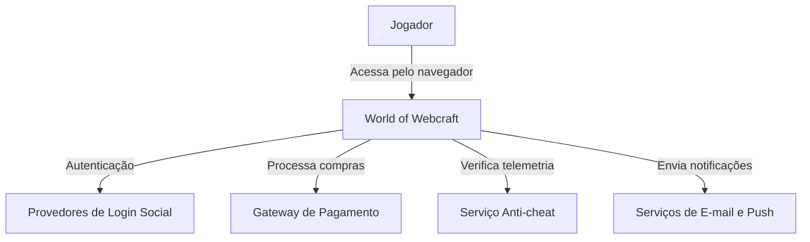
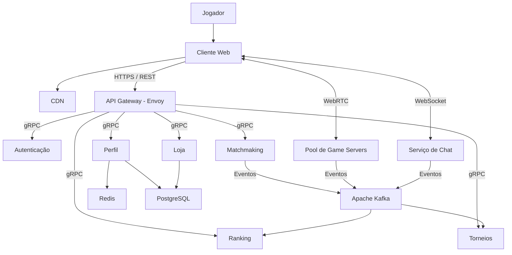
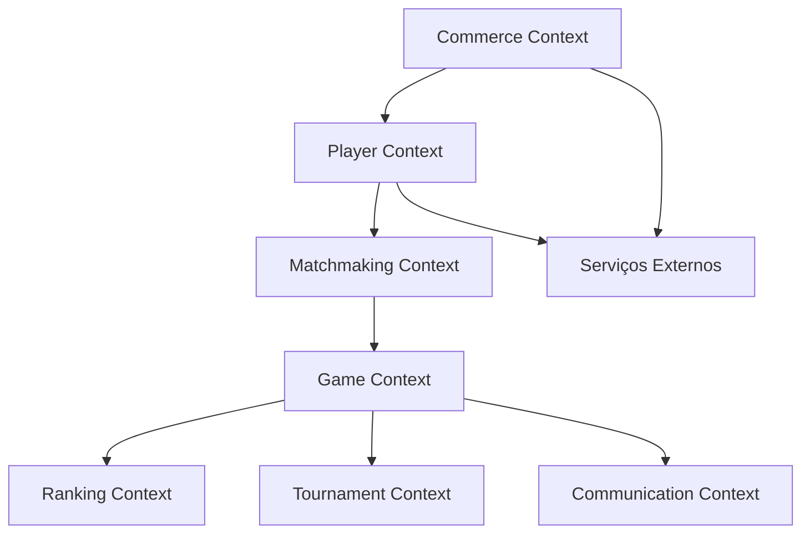
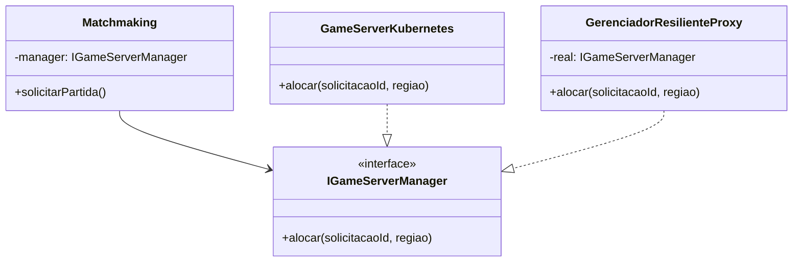
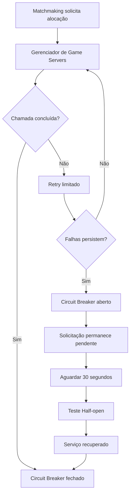

# World of Webcraft
## Documentação de Arquitetura de Software — Sprint 4

> **Architectural Kata:** World of Webcraft  
> **Disciplina:** Arquitetura de Software  
> **Período:** 6º período  
> **Equipe:** DevTech  
> **Projeto:** Sprint 4 — Trabalho Final em Equipe

---

## 1. Identificação da equipe

| Integrante | Responsabilidade | GitHub |
|---|---|---|
| Pamela da Silva | Líder e Arquiteto Principal | @PamelaMachad00 |
| Maria Vitória Souza | Pesquisador e Modelagem DDD | @MariaVitoria-S |
| Caio André Gouveia  | Pesquisador e Engenheiro de Resiliência e Integração | @CaioGouveia924 |
| Cibely Godoy Martins | Executor e Especialista em IA-Native e Autonomia | @CibelyMartins |
| Mariana Felix Cardoso | Executor, QA e Desenvolvedor de Fitness Functions | @mareeu |

---

# 2. Visão geral do sistema

O **World of Webcraft** é um jogo de tiro em primeira pessoa (FPS) multiplayer massivo, executado inteiramente pelo navegador, sem necessidade de instalação de um cliente nativo.

O sistema foi projetado para suportar milhões de jogadores simultâneos, partidas em tempo real, salas privadas de torneios e comunicação por chat. Sua arquitetura precisa atender a requisitos rigorosos de escalabilidade, desempenho, disponibilidade e segurança.

A proposta arquitetural utiliza serviços distribuídos, comunicação síncrona e assíncrona, servidores regionais de partida e mecanismos de resiliência para evitar que falhas isoladas comprometam toda a experiência dos jogadores.

### 2.1 Objetivos arquiteturais

- Suportar até 5 milhões de jogadores simultâneos.
- Manter baixa latência durante as partidas.
- Permitir escalabilidade horizontal dos servidores de jogo.
- Garantir continuidade das partidas diante de falhas parciais.
- Separar responsabilidades entre os serviços.
- Processar grandes volumes de eventos e mensagens.
- Permitir integração com serviços externos sem acoplar o domínio às implementações de terceiros.
- Executar o jogo diretamente no navegador, utilizando tecnologias web.

### 2.2 Principais funcionalidades

- Autenticação e gerenciamento de contas.
- Criação e participação em partidas multiplayer.
- Matchmaking e alocação regional de servidores.
- Salas privadas e torneios.
- Chat em tempo real.
- Ranking e progressão dos jogadores.
- Loja e gerenciamento de inventário.
- Integração com sistemas externos de pagamento, login social e anti-cheat.

---

# 3. Requisitos arquiteturais e atributos de qualidade

A arquitetura foi orientada pelos resultados do Quality Attribute Workshop (QAW), que identificou os principais atributos de qualidade e priorizou os riscos técnicos do sistema.

### 3.1 Árvore de utilidade

| Atributo | Subatributos |
|---|---|
| Escalabilidade | Quantidade de jogadores simultâneos e picos de acesso |
| Performance | Latência de rede e taxa de atualização |
| Disponibilidade | Tolerância a falhas e continuidade das partidas |
| Segurança | Anti-cheat e proteção de contas |
| Interoperabilidade | Execução em navegadores desktop e mobile |

### 3.2 Cenários de qualidade

| ID | Atributo | Cenário |
|---|---|---|
| S1 | Escalabilidade | Suportar um pico de 500 mil novos jogadores em 10 minutos. |
| S2 | Performance | Processar inputs de combate com baixa latência durante partidas ativas. |
| S3 | Disponibilidade | Manter a continuidade das partidas quando um nó de infraestrutura falhar. |
| S4 | Segurança | Identificar inputs fisicamente impossíveis, como aimbot e speedhack. |
| S5 | Escalabilidade do chat | Suportar até 10 mil espectadores simultâneos por sala de torneio. |
| S6 | Interoperabilidade | Permitir acesso pelo navegador em dispositivos desktop e mobile. |

### 3.3 Priorização dos cenários

| Cenário | Valor de negócio | Risco técnico | Prioridade |
|---|---|---|---|
| S1 — Escalabilidade de picos | Alto | Alto | 1º |
| S2 — Latência em combate | Alto | Alto | 2º |
| S3 — Disponibilidade | Médio | Médio | 3º |
| S4 — Anti-cheat | Alto | Médio | 4º |
| S5 — Escala do chat | Médio | Baixo | 5º |
| S6 — Interoperabilidade | Médio | Baixo | 6º |

Os cenários S1 e S2 foram considerados prioritários por representarem os maiores riscos técnicos e impacto direto na experiência dos jogadores.

### 3.4 Estimativas BOTE

Foram realizadas estimativas simplificadas para compreender a ordem de grandeza da infraestrutura necessária.

| Indicador | Premissa | Estimativa |
|---|---|---|
| Jogadores simultâneos | CCU alvo | 5.000.000 |
| Jogadores por partida | 20 jogadores | 250.000 partidas simultâneas |
| Taxa de atualização | 20 Hz | 20 atualizações por segundo |
| Tráfego de estado | 500 bytes por pacote | 50 GB/s agregados |
| Tráfego de input | 100 bytes por pacote | 10 GB/s agregados |
| Capacidade de CPU | 1 ms por tick por partida | Aproximadamente 5.000 cores |
| Leituras de perfil | Uma consulta a cada 5 minutos por jogador | Aproximadamente 16.700 leituras/s |
| Chat | 50 torneios com 10 mil espectadores | Até 100 mil mensagens/s |

Os valores representam estimativas iniciais de dimensionamento, não benchmarks reais de produção.

---

# 4. Arquitetura do sistema — Modelo C4

A arquitetura utiliza serviços distribuídos, com separação entre funcionalidades de negócio, comunicação em tempo real, processamento de eventos e persistência de dados.

## 4.1 C4 — Nível 1: Diagrama de contexto

O jogador interage com o World of Webcraft por meio de um navegador. O sistema se comunica com serviços externos para autenticação social, pagamentos, anti-cheat e envio de notificações.

## 4.2 C4 — Nível 2: Diagrama de contêineres

Os principais contêineres e tecnologias propostos são:

| Contêiner | Responsabilidade | Tecnologia ou comunicação |
|---|---|---|
| Cliente Web | Interface e execução do jogo | WebGL/WebGPU |
| CDN | Distribuição de recursos estáticos | HTTPS |
| API Gateway | Entrada e roteamento das requisições | Envoy |
| Autenticação | Gerenciamento de identidade | gRPC |
| Matchmaking | Formação e encaminhamento de partidas | gRPC e Kafka |
| Pool de Game Servers | Simulação autoritativa das partidas | WebRTC DataChannel |
| Serviço de Chat | Comunicação entre jogadores | WebSocket e Kafka |
| Ranking | Atualização e consulta de classificações | gRPC e Kafka |
| Torneios | Gerenciamento de salas e competições | gRPC e Kafka |
| Loja | Compras e inventário | gRPC e integração externa |
| Broker de eventos | Comunicação assíncrona | Apache Kafka |
| Cache | Dados de acesso frequente | Redis |
| Banco de dados | Persistência de contas e inventário | PostgreSQL |

### Diagrama de contêineres simplificado

**Observação:** o diagrama é uma representação simplificada dos principais fluxos. Os protocolos e integrações detalhados estão descritos na ADR-005.

## 4.3 C4 — Nível 3: Componentes

O detalhamento de componentes concentra-se nos serviços com maior relevância arquitetural.

### Matchmaking

Responsável por receber solicitações, organizar jogadores em filas e solicitar a alocação de servidores.

Componentes propostos:

- `MatchmakingController`: recebe solicitações de entrada em partidas.
- `Matchmaker`: aplica as regras de pareamento.
- `IGameServerManager`: contrato de comunicação com o gerenciador de servidores.
- `GameServerKubernetes`: implementação responsável pela alocação de instâncias.
- `GerenciadorResilienteProxy`: aplica mecanismos de proteção e resiliência.

### Serviço de Perfil

Responsável por consultar e atualizar dados dos jogadores.

Componentes:

- Gerenciador de perfis.
- Repositório de dados.
- Integração com PostgreSQL.
- Cache de consultas utilizando Redis.

### Pool de Game Servers

Responsável pela execução autoritativa das partidas.

Responsabilidades:

- Processar os inputs dos jogadores.
- Atualizar o estado da partida.
- Enviar atualizações em tempo real.
- Publicar eventos de partida e telemetria.

---

# 5. Domain-Driven Design (DDD)

A arquitetura organiza as funcionalidades em domínios de negócio, buscando reduzir o acoplamento e manter as regras de cada contexto separadas.

Os contextos abaixo representam uma proposta de organização baseada nos serviços identificados nas sprints. A delimitação definitiva dos Bounded Contexts e seus contratos deverá ser validada pela equipe.

## 5.1 Subdomínios identificados

| Subdomínio | Classificação proposta | Responsabilidade |
|---|---|---|
| Partidas | Core Domain | Execução e gerenciamento das partidas. |
| Matchmaking | Core Domain | Formação de partidas e alocação de jogadores. |
| Torneios | Supporting Domain | Organização de salas e competições. |
| Chat | Supporting Domain | Comunicação entre jogadores. |
| Ranking | Supporting Domain | Classificação e progressão. |
| Perfil | Supporting Domain | Dados e inventário dos jogadores. |
| Autenticação | Generic Domain | Identidade e acesso. |
| Pagamentos | Generic Domain | Processamento de compras. |
| Notificações | Generic Domain | Comunicação externa com jogadores. |

## 5.2 Bounded Contexts

A proposta de separação dos contextos considera as seguintes responsabilidades:

- **Game Context:** regras e estado das partidas.
- **Matchmaking Context:** filas, critérios de pareamento e alocação.
- **Player Context:** identidade, perfil e inventário.
- **Tournament Context:** salas privadas, rodadas e competições.
- **Communication Context:** chat e notificações.
- **Commerce Context:** compras e pagamentos.
- **Ranking Context:** pontuação e classificação dos jogadores.

Os contextos devem possuir modelos próprios e comunicar-se por contratos explícitos, evitando compartilhar diretamente estruturas internas de dados.

## 5.3 Context Map

## 5.4 Anti-Corruption Layer (ACL)

A Camada Anticorrupção será utilizada nas integrações com sistemas externos para impedir que modelos de terceiros contaminem os modelos internos do domínio.

Aplicações previstas:

| Integração | Responsabilidade da ACL |
|---|---|
| Login social | Converter respostas de provedores externos em `PlayerIdentity`. |
| Gateway de pagamento | Converter retornos de pagamento em eventos internos, como `CompraConfirmada`. |
| Anti-cheat | Traduzir telemetria e resultados de verificação para contratos internos. |
| E-mail e Push | Converter solicitações internas de notificação para os formatos dos provedores. |

O padrão Adapter pode ser utilizado na implementação dessas camadas.

---

# 6. Princípios SOLID e padrões de projeto

A arquitetura utiliza princípios SOLID e padrões GoF para reduzir o acoplamento, facilitar testes e permitir substituição de implementações.

## 6.1 Princípios SOLID

| Princípio | Aplicação no World of Webcraft |
|---|---|
| SRP — Responsabilidade Única | Cada serviço possui responsabilidades específicas, como perfil, matchmaking e partidas. |
| OCP — Aberto/Fechado | Novas estratégias de pareamento podem ser adicionadas sem modificar o fluxo principal. |
| LSP — Substituição de Liskov | Implementações de interfaces podem ser substituídas mantendo o contrato esperado. |
| ISP — Segregação de Interfaces | Interfaces devem expor apenas operações necessárias aos consumidores. |
| DIP — Inversão de Dependência | O Matchmaking depende de `IGameServerManager`, não diretamente da implementação concreta de servidores. |

### Exemplo de DIP

## 6.2 Padrões GoF aplicáveis

| Padrão | Aplicação |
|---|---|
| Factory Method | Criação de componentes de infraestrutura e canais de comunicação. |
| Abstract Factory | Criação de famílias de componentes para produção e testes. |
| Builder | Construção de salas privadas de torneio com configurações variadas. |
| Prototype | Criação de partidas a partir de configurações-base. |
| Adapter | Integração com provedores externos de pagamento e anti-cheat. |
| Decorator | Adição de compressão e monitoramento aos canais de comunicação. |
| Facade | Simplificação do fluxo de entrada em partidas por meio de uma interface coordenadora. |
| Proxy | Proteção das chamadas entre Matchmaking e gerenciador de servidores. |
| Strategy | Alternância entre critérios de pareamento, como habilidade ou latência. |
| Observer | Notificação de componentes após eventos de partida. |
| State | Representação dos estados de solicitações e do Circuit Breaker. |
| Chain of Responsibility | Aplicação sequencial de filtros nas mensagens do chat. |
| Mediator | Coordenação das interações entre jogadores em um lobby. |
| Memento | Armazenamento de estados recentes para análise de disparos. |
| Iterator | Percurso de jogadores próximos em uma estrutura espacial. |
| Template Method | Definição de etapas comuns do ciclo de uma partida. |

## 6.3 Padrões de apresentação

Para a interface web, foram estudados três padrões:

- **MVC:** separa Model, View e Controller.
- **MVP:** utiliza um Presenter para intermediar a comunicação entre View e Model.
- **MVVM:** utiliza um ViewModel para organizar os dados e a comunicação com a interface.

No World of Webcraft, esses padrões são adequados principalmente às telas de perfil, lobby, chat e menus. A tela de combate possui requisitos específicos de atualização em tempo real e não deve receber camadas desnecessárias que prejudiquem seu desempenho.

---

# 7. Resiliência e integração entre serviços

A arquitetura utiliza comunicação síncrona e assíncrona conforme a necessidade de cada fluxo.

## 7.1 Protocolos de comunicação

| Comunicação | Protocolo | Finalidade |
|---|---|---|
| Navegador → API Gateway | REST/JSON sobre HTTPS | Login, perfil, loja e solicitações de partida. |
| API Gateway → serviços internos | gRPC/Protobuf sobre HTTP/2 | Comunicação interna com contratos tipados. |
| Navegador ↔ Game Servers | WebRTC DataChannel | Atualização do estado das partidas. |
| Navegador ↔ Chat | WebSocket seguro | Mensagens bidirecionais. |
| Serviços → Broker | Apache Kafka | Publicação e consumo de eventos. |
| Serviços → sistemas externos | HTTPS/REST/OAuth2 via ACL | Integração com terceiros. |

### 7.2 Frameworks de integração

**Envoy Proxy**

Responsável pela integração síncrona, roteamento de requisições, conversão REST/JSON para gRPC e aplicação de políticas de comunicação, como rate limiting e circuit breaker.

**Dapr Pub/Sub sobre Kafka**

Responsável por facilitar a comunicação assíncrona entre serviços, oferecendo mecanismos de publicação, retentativas, dead-letter queue e padronização de eventos.

Para fluxos de volume elevado, como o Pool de Game Servers e o Serviço de Chat, são previstos clientes Kafka nativos para reduzir a sobrecarga de processamento.

## 7.3 Eventos de domínio

Os principais eventos identificados são:

- `PartidaFormada`
- `PartidaFinalizada`
- `TelemetriaPartida`
- `MensagemChat`
- `CompraConfirmada`
- `NotificaçãoSolicitada`

Os eventos são publicados no Kafka e consumidos pelos serviços interessados.

## 7.4 Estratégias de resiliência

O fluxo considerado mais crítico é a comunicação entre Matchmaking e o Gerenciador de Game Servers.

| Mecanismo | Configuração proposta |
|---|---|
| Timeout | 1,5 segundo por chamada de alocação. |
| Retry | Até duas novas tentativas para falhas transitórias e operações idempotentes. |
| Backoff | 200 ms e 400 ms, com jitter. |
| Circuit Breaker | Abre quando pelo menos 50% das últimas chamadas falham, com mínimo de 10 chamadas em uma janela de 10 segundos. |
| Half-open | Após 30 segundos, libera chamadas de teste. |
| Fallback | Mantém a solicitação pendente e informa o jogador que a busca continua ou está temporariamente indisponível. |
| Idempotência | Identificador único para impedir alocações duplicadas. |

### 7.5 Fluxo de falha

## 7.6 Governança de eventos

- Versionar contratos `.proto` e esquemas de eventos.
- Utilizar Schema Registry com compatibilidade retroativa.
- Padronizar nomes de tópicos no formato `<domínio>.<evento>.v<versão>`.
- Propagar identificadores de correlação.
- Garantir idempotência nos consumidores.
- Utilizar rastreamento distribuído com OpenTelemetry.
- Manter retenção proposta de 7 dias para telemetria e 30 dias para eventos de partidas.

---

# 8. Arquitetura AI-Native e autonomia

A documentação das sprints anteriores não registra uma funcionalidade de IA integrada ao produto nem a implementação de agentes autônomos. Portanto, esta seção apresenta possibilidades de evolução, sem afirmar que já fazem parte da arquitetura aprovada.

## 8.1 Possíveis aplicações de IA

| Área | Aplicação possível | Benefício esperado |
|---|---|---|
| Anti-cheat | Análise de padrões de comportamento e telemetria. | Identificação de comportamentos suspeitos. |
| Operações | Análise de métricas e logs de infraestrutura. | Apoio ao diagnóstico de falhas. |
| Matchmaking | Análise de dados de latência e habilidade. | Apoio à melhoria dos critérios de pareamento. |
| Suporte | Assistente para dúvidas e problemas dos jogadores. | Redução do tempo de atendimento. |

## 8.2 Autonomia e limites

Caso agentes de IA sejam incorporados futuramente, deverão respeitar limites explícitos de atuação.

- Ações críticas de infraestrutura devem exigir políticas de autorização.
- Alterações em contas, pagamentos e punições devem possuir mecanismos de auditoria.
- Dados pessoais devem ser tratados conforme requisitos de privacidade.
- Decisões automatizadas devem ser monitoráveis e passíveis de revisão.
- A IA não deve assumir autoridade sobre a simulação das partidas.

## 8.3 Estado atual

**Status: proposta de evolução.**

A adoção de IA deverá ser acompanhada de uma decisão arquitetural específica, definindo o modelo utilizado, os dados acessados, os limites de autonomia, os mecanismos de segurança e os critérios de avaliação.

---

# 9. Architecture Decision Records (ADRs)

As ADRs registram as decisões arquiteturais, alternativas consideradas e consequências técnicas.

| ADR | Decisão | Situação |
|---|---|---|
| ADR-001 | Protocolo de comunicação em tempo real — WebRTC DataChannel | Definida na Sprint 1 |
| ADR-002 | Infraestrutura de servidores com containers e escalabilidade horizontal | Definida na Sprint 1 |
| ADR-003 | Persistência com PostgreSQL, réplicas de leitura e Redis | Definida na Sprint 1 |
| ADR-004 | Protocolos de comunicação e mecanismos de resiliência | Proposta na Sprint 3 |
| ADR-005 | Integração entre contêineres com gRPC, Kafka, Envoy e Dapr | Registrada na evolução arquitetural |

### ADR-001 — Comunicação em tempo real

**Contexto:** o sistema precisa atualizar o estado das partidas com baixa latência e alta frequência.

**Decisão:** utilizar WebRTC DataChannel para comunicação em tempo real entre navegador e servidores de jogo.

**Alternativa considerada:** utilizar WebSocket em todos os fluxos.

**Justificativa:** o DataChannel permite comunicação adequada ao tráfego de estado de jogo, evitando que a perda de um pacote bloqueie a entrega dos seguintes quando configurado como não confiável e não ordenado.

### ADR-002 — Infraestrutura de servidores

**Contexto:** a quantidade de partidas simultâneas exige capacidade de processamento distribuída e escalável.

**Decisão:** utilizar containers e orquestração com Kubernetes, permitindo escalabilidade horizontal dos servidores de jogo.

**Consequências:** maior flexibilidade de capacidade, com aumento da complexidade operacional e necessidade de monitoramento da infraestrutura.

### ADR-003 — Persistência e cache

**Contexto:** a quantidade de jogadores gera grande volume de consultas de perfil.

**Decisão:** utilizar PostgreSQL com um nó primário e pelo menos duas a três réplicas de leitura, complementado por Redis para dados acessados frequentemente.

**Consequências:** redução da pressão de leitura sobre o banco principal, com possibilidade de atraso na replicação e necessidade de tratar consistência eventual.

### ADR-004 — Protocolos e resiliência

**Contexto:** diferentes fluxos exigem características distintas de comunicação e tolerância a falhas.

**Decisão:** utilizar WebRTC para partidas, WebSocket para chat, REST/JSON para operações externas ao combate e Kafka para eventos assíncronos. Aplicar Timeout, Retry, Circuit Breaker e Fallback na alocação de servidores.

**Consequências:** maior isolamento de falhas e escalabilidade, com aumento da complexidade de operação e monitoramento.

### ADR-005 — Integração entre contêineres

**Contexto:** os serviços possuem necessidades de comunicação distintas e podem ser implementados em linguagens diferentes, como Go, Node.js e C++.

**Decisão:** utilizar REST/JSON no acesso do navegador, gRPC/Protobuf na comunicação interna, Kafka para eventos, Envoy na integração síncrona e Dapr Pub/Sub sobre Kafka na integração assíncrona.

**Alternativas consideradas:** YARP e MassTransit, REST em todos os fluxos, RabbitMQ e clientes Kafka nativos em todos os serviços.

**Consequências:** contratos mais explícitos, comunicação desacoplada e melhor capacidade de processamento de eventos, com maior complexidade operacional, consistência eventual e necessidade de idempotência.

---

# 10. Fitness Functions e validação arquitetural

As Fitness Functions são mecanismos de verificação contínua que permitem avaliar se a arquitetura continua atendendo aos atributos de qualidade definidos.

Como o projeto é uma proposta arquitetural e não há comprovação de execução automatizada de todas essas verificações, os itens abaixo representam critérios de validação propostos.

## 10.1 Métricas de desempenho

| Indicador | Critério de validação |
|---|---|
| Latência percebida no combate | Round-trip inferior a 100 ms para 95% dos jogadores, conforme meta definida na Sprint 1. |
| Comunicação gRPC interna | p95 abaixo de 20 ms. |
| Processamento do Kafka | Sustentar 100 mil mensagens/s de chat, além da telemetria. |
| Atraso de consumidores Kafka | Consumer lag abaixo de 2 segundos. |
| Consultas de perfil | Sustentar aproximadamente 16.700 leituras/s, com p99 abaixo de 50 ms. |

## 10.2 Testes de resiliência

- Simular indisponibilidade do Gerenciador de Game Servers.
- Verificar o acionamento do Circuit Breaker.
- Confirmar que novas tentativas respeitam os limites definidos.
- Verificar se solicitações duplicadas são impedidas.
- Confirmar que partidas já iniciadas continuam funcionando.
- Simular indisponibilidade dos serviços de Ranking e Notificações sem interromper partidas em andamento.

## 10.3 Testes de integração

- Validar contratos REST e gRPC.
- Verificar compatibilidade dos schemas de eventos.
- Validar a comunicação entre produtores e consumidores Kafka.
- Testar as ACLs com respostas simuladas de provedores externos.
- Verificar o comportamento dos serviços diante de eventos duplicados.

## 10.4 Fitness Functions automatizáveis

| Verificação | Forma de automatização |
|---|---|
| Contratos de API | Testes de contrato e validação OpenAPI. |
| Contratos de eventos | Validação de schemas no Schema Registry. |
| Limites de latência | Testes de carga e monitoramento de métricas p95/p99. |
| Resiliência | Testes automatizados de falhas e recuperação. |
| Dependências entre serviços | Análise estática e testes arquiteturais específicos para cada linguagem. |
| Segurança das integrações | Testes de autenticação, autorização e validação das ACLs. |

**Observação:** ArchUnit é uma alternativa para projetos Java. Como a arquitetura do World of Webcraft prevê Go, Node.js e C++, a ferramenta de verificação deverá ser escolhida conforme a linguagem e a estrutura de cada serviço.

---

# 11. Riscos e pontos de atenção

| Risco | Impacto | Mitigação proposta |
|---|---|---|
| Cold start de containers | Alto | Manter um conjunto de instâncias aquecidas. |
| Atraso de replicação PostgreSQL | Médio | Direcionar leituras críticas imediatamente após escrita ao nó primário. |
| Falhas de NAT traversal no WebRTC | Médio | Utilizar fallback para WebSocket seguro. |
| Separação geográfica de jogadores | Baixo | Permitir matchmaking entre regiões com aviso de latência. |
| Falha de consumidores Kafka | Alto | Utilizar retentativas, DLQ e consumidores idempotentes. |
| Complexidade de operação distribuída | Alto | Adotar observabilidade, rastreamento distribuído e governança de contratos. |
| Dependência de serviços externos | Médio | Utilizar ACL e Adapter para isolar fornecedores. |

---

# 12. Considerações finais

A arquitetura proposta para o World of Webcraft evoluiu ao longo das sprints, partindo da identificação dos atributos de qualidade e estimativas de capacidade até a definição de serviços, protocolos de comunicação, integração e mecanismos de resiliência.

As decisões arquiteturais priorizam escalabilidade e baixa latência, principalmente por se tratar de um jogo multiplayer com grande quantidade de jogadores simultâneos e atualizações frequentes de estado.

A utilização de serviços distribuídos, Kubernetes, WebRTC, gRPC, Kafka, Redis e PostgreSQL busca atender às necessidades identificadas, enquanto os princípios SOLID, padrões GoF e mecanismos de integração contribuem para reduzir o acoplamento e facilitar a evolução do sistema.

Por fim, a documentação de ADRs e a definição de Fitness Functions permitem estabelecer critérios para avaliar as decisões e acompanhar a qualidade da arquitetura ao longo de sua evolução.

---

# 13. Referências

- GAMMA, E.; HELM, R.; JOHNSON, R.; VLISSIDES, J. *Padrões de projeto: soluções reutilizáveis de software orientado a objetos*. Porto Alegre: Bookman, 2000.
- MARTIN, R. C. *Arquitetura limpa: o guia do artesão para estrutura e design de software*. Rio de Janeiro: Alta Books, 2019.
- RICHARDS, M.; FORD, N. *Fundamentos da arquitetura de software: uma abordagem de engenharia*. Rio de Janeiro: Alta Books, 2024.
- MICROSOFT. *Padrão de Disjuntor*. Microsoft Learn.
- MICROSOFT. *Model-View-ViewModel (MVVM)*. Microsoft Learn.
- REFACTORING GURU. *Padrões de projeto*. Disponível em: https://refactoring.guru/pt-br/design-patterns.

---

## 14. Histórico de evolução

| Etapa | Principais entregas |
|---|---|
| Sprint 1 | QAW, estimativas BOTE, identificação dos atributos de qualidade e ADRs iniciais. |
| Sprint 2 | Métricas de dependência, aplicação do DIP e definição da arquitetura baseada em serviços. |
| Sprint 3 | Evolução do C4, contratos OpenAPI, protocolos de comunicação e mecanismos de resiliência. |
| Sprint 4 | Evolução da integração entre contêineres, DDD, ACL, governança de eventos e consolidação arquitetural. |
| APS 2 | Estudo e aplicação dos padrões GoF, SOLID e padrões de apresentação. |

---

**Projeto:** World of Webcraft  
**Equipe:** DevTech  
**Disciplina:** Arquitetura de Software  
**Ano:** 2026
